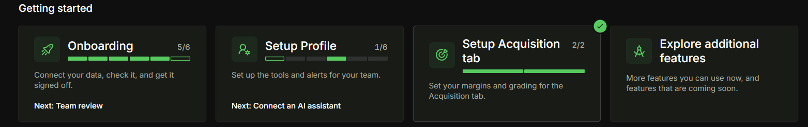
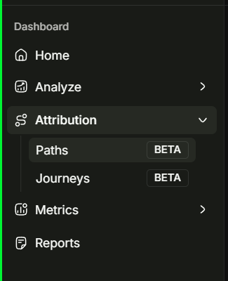
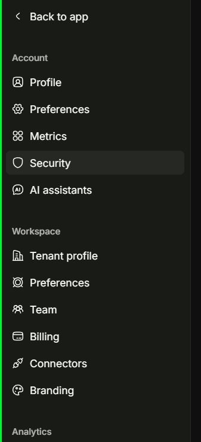

import { Aside } from '@astrojs/starlight/components';

Three parts of Consequential are worth knowing on day one: the **Getting started** cards on Home, the **dashboard sidebar**, and **Settings**. This page explains each one.

## Getting started cards

Home shows four setup cards. Click a card to see its steps and act on them. The header shows **Finish setup x/y**, which adds up the first three cards.

How to read a card:

- **x/y** counts the steps that are done or skipped, out of the steps that apply to your workspace. Steps that don't apply are hidden.
- **The bar** has one segment per step. Solid is done, striped is skipped, outlined is the next step, and yellow means a data source is not up to date.
- **Next** names the next step to do.
- **A green tick** on the corner means every step is done or skipped. A yellow **!** means a data source in that group is not up to date.

### Onboarding

Connect your data, check it, and get it signed off. Only Owners and Admins can do these steps.

| Step | Done when | Required |
| --- | --- | --- |
| Connect your store | Shopify or another store platform is connected. See [Connect your store](/get-started/connect-your-store/). | Yes |
| Connect your ad accounts | A Meta, Google or TikTok ad account is connected, by you or by our team. | Yes |
| Connect Google Analytics 4 | GA4 is connected. See [Connect Google Analytics 4](/get-started/connect-ga4/). | No |
| Connect your email tool | Klaviyo or another email tool is connected. | No |
| Check your data | You confirm that the numbers we loaded look right. | Yes |
| Team review | Our team checks your data before your account goes live. You don't need to do anything. | Yes |

### Setup Profile

Set up the tools and alerts for your team. Most of these steps are personal, so each person in the workspace has their own.

| Step | Done when | Who |
| --- | --- | --- |
| Connect an AI assistant | Claude or ChatGPT connects to your data. See [Connect your AI assistant](/academy/mcp-guide/connect-your-ai-assistant-to-consequential-analytics/). | Each person |
| Customize your daily report | You save your daily report setup. See [Configure and schedule daily reports](/daily-reports/configure-and-schedule-daily-reports/). | Each person |
| Set your notifications | You review your alerts and emails in **Settings → Preferences**. | Each person |
| Invite your team | Your workspace has a second member. | Owners and Admins |
| Pin your key metrics | You pin a metric to Home from the **Metrics** page. | Each person |
| Select a plan | You pick a plan. This step is hidden if our sales team manages your plan. | Owners and Admins |
| Watch the walkthrough | You watch the short video about the app. It shows only when a video is available. | Each person |

### Setup Acquisition tab

Set your margins and grading for the Acquisition tab. This card shows only when the Acquisition tab is on for your workspace. Only Owners and Admins can do these steps.

| Step | Done when |
| --- | --- |
| Set your profit margin | You save your contribution margin in **Settings → Acquisition**. We use it to grade your ads on profit. |
| Set your grading rules | You save your grading rules in **Settings → Scores & grading**. |

### Explore additional features

This card lists features that are coming soon. Click **Notify me** to hear when one is ready. Nothing on this card counts toward your setup.

## Dashboard sidebar

The sidebar lists the pages you use every day.

| Entry | Pages | What it shows |
| --- | --- | --- |
| Home | — | Your pinned metrics and the Getting started cards. While your data is still loading, Home also shows its progress. |
| Analyze | Acquisition, Alerts, Explorer, Conversion | **Acquisition** shows ad performance by channel, campaign and ad, with grades. See [Understand the Acquisition Dashboard](/acquisition-dashboard/understand-the-acquisition-dashboard/). **Alerts** and **Explorer** are early-access tools for Acquisition. **Conversion** shows your funnel and its breakdowns. |
| Attribution | Model report, Paths, Journeys | **Model report** shows revenue credited to channels under each attribution model. **Paths** shows the touches that came before orders, in the order they happened, for the last 7, 30 or 90 days. **Journeys** lets you look up one order or customer by number and see every touch that led to the purchase. |
| Metrics | Category, Funnel, Source | Every metric, grouped by category, by funnel stage, and by data source. Pin metrics to Home from here. See [Explore a metric](/metrics-explorer/explore-a-metric/). |
| Reports | — | Your past daily reports. See [View and interpret your daily report](/daily-reports/view-and-interpret-your-daily-report/). |

Below these, the sidebar always has **Support** (these docs), **Community** (our Slack community) and **Settings**.

<Aside type="note">
Pages marked **BETA** are in early access, and some pages are turned on workspace by workspace. Your sidebar may show more or fewer pages than the picture. If you expect a page and don't see it, contact [support@consequential.io](mailto:support@consequential.io).
</Aside>

## Settings

Settings has its own sidebar. **Back to app** returns to the dashboard.

At the top of the sidebar, the switcher shows the store or view you are looking at, and your workspace name below it. A view combines stores, for example **All stores**. Click it to switch store, view or workspace.

### Account

These settings are yours alone. Changing them doesn't affect anyone else in the workspace.

| Page | What you can do |
| --- | --- |
| Profile | Change your name and avatar, and see the email you sign in with. |
| Preferences | Choose your display and number formats, and the alerts and emails you get. |
| Metrics | Set the order, visibility and layout of the Metrics page, and the top metrics on Home. |
| Security | See where you are signed in, and the applications connected to your account. |
| AI assistants | Connect Claude or ChatGPT to your data, and see which assistants have access. |

### Workspace

These settings apply to everyone in the workspace.

| Page | What you can do |
| --- | --- |
| Tenant profile | Change the workspace name and default store. |
| Preferences | Set the currency and display settings for the workspace and its stores. |
| Team | See members and pending invitations, invite people, answer access requests, and remove members. |
| Billing | See your plan, billing period and next billing date. |
| Connectors | See and manage the data sources connected to the workspace. |
| Branding | Set the logo and colors used in the app and in emails. |

### Analytics

These settings change how your numbers are calculated and graded, for everyone in the workspace.

| Page | What you can do |
| --- | --- |
| Guidelines | Set the attribution and conversion rules that drive your metrics. |
| Reports | Choose when your daily report is sent, who gets it, and what is in it. |
| Profitability | Set your contribution-margin model and P&L assumptions. They drive POAS and breakeven ROAS. Shows only when it is on for your workspace. |
| Scores & grading | Set the letter-grade thresholds and segment cutoffs for ad grades. |
| Journeys | Set the roll-up depth and sub-channel limits for journey paths. Shows only when Paths or Journeys is on. |
| UTM Score | Set the weights behind the UTM Health score. Shows only when UTM Health is on. |
| Badges | Set the rules for the performance badges on campaigns, ad sets, creatives and pages. |

## Who can change what

There are five roles in a workspace: Owner, Admin, Manager, Editor and Viewer.

- Everyone can change their own **Account** settings and do their own Setup Profile steps.
- Only **Owners and Admins** can change **Workspace** and **Analytics** settings. Other roles can open these pages but can't change them.
- Billing is read-only in the app for every role.

<Aside type="note">
If you have any questions, contact [support@consequential.io](mailto:support@consequential.io).
</Aside>
